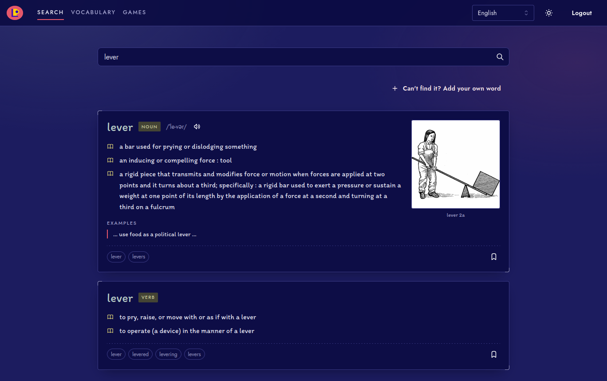
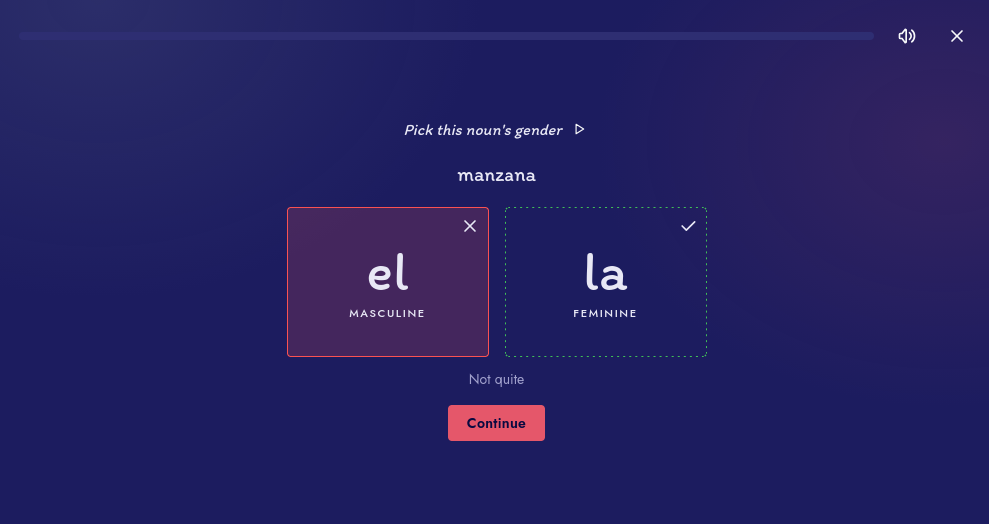

# Language Power Frontend

[](https://github.com/marusyaganza/language-power-client/actions/workflows/ci.yml)

React + TypeScript client for the current version of the Language Power application.

Language Power is a web app for language learners. Users look up words, save them to a personal vocabulary, edit them, and practise them in small learning games scheduled with spaced repetition. This is the React client for Language Power v3, built with Vite and TypeScript. It consumes the v3 FastAPI backend ([language-power-api](https://github.com/marusyaganza/language-power-api)), which owns data, accounts, dictionary lookups and game scheduling. Everything except the landing, login and sign-up pages requires a signed-in user.

**Live demo: [language-power.netlify.app](https://language-power.netlify.app/)**. Sign up with any email address; demo accounts are deleted after 24 hours. See [Demo](#demo) for the limits.





## Status

- Active development
- Deployed twice from the same build: a public demo and a private instance. Frontend on Netlify, API on Google Cloud Run
- Built and tested against the v3 FastAPI backend

## Features

- Sign up, log in and log out with a server-side session (cookie-based). The backend can turn sign-up off
- Switch the study language (Spanish or English)
- Search the dictionary, with spelling suggestions when a word isn't found
- Save words from search results or add your own, then edit definitions, examples, pronunciation audio and image
- Browse the vocabulary with search, sorting and pagination kept in the URL
- Practise saved words in six games: Pick the Meaning, Pick the Word, Type the Word, Listen & Type, Name the Picture and Noun Gender (Spanish only)
- Two game modes: spaced repetition (only words that are due) and review (any saved word)
- Adjust the spaced repetition settings: learning steps, review intervals, strict mode, with presets
- Pronunciation audio in games, with a mute option
- Light and dark theme. Theme, study language and sound are remembered per user on the device

Search results come from the [Merriam-Webster Dictionary API](https://dictionaryapi.com/) and credit it with the Merriam-Webster logo, as the API's terms require. For local development and tests, the backend has a mock mode with a few made-up entries in Merriam-Webster's format; the search page lists them, and shows a "Mock dictionary" label instead of the logo.

## Demo

The public demo is at [language-power.netlify.app](https://language-power.netlify.app/). It runs the same build as the private deployment. The backend's settings make it a demo, and `/auth/config` tells the client about them:

- Sign-up is open, and any email address works. Nothing is ever sent to it
- Search uses the live Merriam-Webster API, limited to 10 searches per language per account. The search page shows how many are left
- Accounts and their data are deleted after 24 hours, and each can save up to 100 words
- New users see a short "search, save, play" guide on the games page

The limits exist because Merriam-Webster's free plan allows 1,000 queries a day per dictionary. The backend also caps the whole demo at 800 searches per language and 50 new accounts a day; when the day's accounts are taken, the sign-up page says when it opens again, in the visitor's own time.

## Tech stack

- React 19
- TypeScript (strict)
- Vite
- React Router 7 (data router, lazy-loaded routes)
- TanStack React Query 5
- Mantine 9 (core, form, modals, notifications)
- Zod
- Vitest
- ESLint (typescript-eslint, React Hooks rules)
- Volta with Node `24.19.0`

## System architecture


The client is the top box: it renders the UI and keeps server data in TanStack Query. Everything else (accounts, the dictionary, vocabulary, scheduling and grading) belongs to the [backend](https://github.com/marusyaganza/language-power-api).

## Project structure

Code is organised by feature over a thin shared layer.

| Path             | Responsibility                                                                     |
| ---------------- | ---------------------------------------------------------------------------------- |
| `src/app`        | Entry point, providers, router, layouts, auth guard, error and 404 screens, error reporting |
| `src/api`        | `apiFetch` (fetch + Zod validation) and `ApiError`                                 |
| `src/config.ts`  | The only module that reads environment variables                                   |
| `src/context`    | Study language (the only React context)                                            |
| `src/features`   | Feature modules: `landing` (public home page), `auth`, `words` (search and vocabulary), `games` |
| `src/shared`     | Components, hooks and helpers used by more than one feature, route paths          |
| `src/theme`      | Mantine theme, design tokens, global styles                                        |

Each feature has the same layout:

```
features/games/
  schemas.ts     Zod schemas for this feature's API responses (types are inferred)
  api.ts         endpoint functions
  queries.ts     query keys and React Query hooks
  lib/           pure logic, unit-tested
  components/
  pages/
  index.ts       public surface for other features
```

Dependencies point one way: `app → features → shared / api / theme / context`. Features use each other only through `index.ts`.

## Requirements

- [Volta](https://volta.sh/)
- Node.js `24.19.0`
- npm
- A running instance of the [v3 backend](https://github.com/marusyaganza/language-power-api)

The Node version is pinned in the `volta` field of `package.json`, so Volta selects it automatically inside the project directory.

## Local development

1. Install [Volta](https://volta.sh/).
2. Install dependencies from the lockfile:

   ```bash
   npm ci
   ```

3. Start the [backend](https://github.com/marusyaganza/language-power-api) locally. The frontend expects it on `http://localhost:8000`.
4. Start the frontend:

   ```bash
   npm run dev
   ```

   The dev server runs on `http://localhost:5173`.

To check a production build locally, run `npm run build` and then `npm run preview`.

## Configuration

The client calls the API on its own origin under `/api`, and a proxy forwards those requests to the backend without the prefix (`/api/auth/me` → `/auth/me`):

| Environment | Proxy                                                | Backend                 |
| ----------- | ---------------------------------------------------- | ----------------------- |
| Development | Vite dev server (`server.proxy` in `vite.config.js`) | `http://localhost:8000` |
| Production  | Netlify rewrite rule in `netlify.toml`               | Google Cloud Run, from the site's `API_ORIGIN` variable |


In production the rewrite is also signed: Netlify adds an `X-Nf-Sign` header to every request it forwards, and the API rejects requests without a valid one, so it can only be reached through the site.

Both Netlify sites (private and demo) build from this repo. `netlify.toml` can't read environment variables, so the build command writes each site's `API_ORIGIN` into the rewrite rule, and fails if it isn't set. `netlify.toml` also sets security headers: a Content-Security-Policy that allows only the site's own scripts and requests (plus Google Fonts, and images and audio from any `https:` host, since users can add their own links), `X-Content-Type-Options` and `Referrer-Policy`.

There are no feature flags in the client. Runtime settings that belong to the backend are fetched from it: `/auth/config` says whether sign-up is enabled and open today, whether the dictionary is mocked, and the demo's limits (searches per language, account lifetime), which are `null` on the private deployment.

### Auth and cookies

Authentication uses a server-side session. The backend sets an `HttpOnly`, `SameSite=Lax` session cookie on login. The client never reads or stores a token.

Because of the proxy, the browser only ever talks to the site's own origin. The cookie is first-party, there are no CORS preflights, and the API's address never reaches the browser. Calling the API directly from another site would not work: a `Lax` cookie isn't sent on cross-site requests.

Any 401 or 403 response makes the app re-check `/auth/me`. If the session is gone, the auth guard redirects to the login page.

## Error reporting

Crashes and unexpected errors on the public demo are reported to [Sentry](https://sentry.io). The private deployment has no DSN, so reporting is off there. It runs in error-only mode: no performance tracing and no session replay, so the only cost is the SDK in the main bundle (about 30 kB gzipped), and a request goes out only when an error is sent.

What gets reported:

- Uncaught errors and unhandled promise rejections
- Errors caught by the route error screen, including page chunks that fail to load
- React errors outside the router
- Failed requests that point to a bug: responses that don't match the Zod schema, 5xx answers, and exceptions thrown by client code. Expected answers (4xx), the dictionary outage (503) and network errors are not reported

Reports carry the user's id, never the email. They are sent through a same-origin `/sentry` route that Netlify forwards to Sentry, so ad blockers don't drop them. The build writes that rule to `dist/_redirects` from the DSN, so the DSN isn't kept in the repo. It isn't secret either: the browser needs it, so it is part of the bundle.

| Variable                  | Where             | Notes                                                                        |
| ------------------------- | ----------------- | ---------------------------------------------------------------------------- |
| `VITE_SENTRY_DSN`         | Netlify (demo)    | Turns reporting on. Without it (private site, local dev, tests) the SDK isn't started |
| `VITE_SENTRY_ENVIRONMENT` | `netlify.toml`    | Set per deploy context: `production`, `deploy-preview`, `branch-deploy`      |
| `SENTRY_AUTH_TOKEN`       | Netlify (secret)  | Build only. Uploads source maps, then deletes them from `dist`               |
| `SENTRY_ORG`, `SENTRY_PROJECT` | Netlify      | Build only. Where the source maps go                                         |

Without `SENTRY_AUTH_TOKEN` the build makes no source maps at all, so they are never published.

## Data flow

- **React Router** handles navigation. Routes are lazy-loaded, and everything behind the auth guard requires a session.
- **React Query is the only store for server data.** Components never call `fetch`. Every query and mutation is a named hook with keys from a per-feature key factory. Mutation hooks own cache updates and toasts, pages own navigation. 4xx responses are not retried.
- **Zod checks the API contract at runtime.** Frontend and backend live in separate repositories with no shared types or code generation, so `apiFetch` parses every response with the feature's schema. A mismatch fails loudly with the request and the field (`Unexpected response from GET /games: … at [0].due_word_count`) instead of turning into `undefined` deep in a component. Request bodies are plain TypeScript types, and the backend validates them.
- **Mantine** provides the UI components, forms, modals and notifications. All colors are tokens defined in `src/theme/theme.ts`.
- **Shareable view state lives in the URL**: vocabulary search, page and sort, and game mode survive reloads and can be linked.
- **Per-user preferences** (theme, study language, sound) are kept in `localStorage`, keyed by user id.

Dictionary search results are kept for the whole visit and never refetched, because on the demo every search request uses up one of the account's searches. Saving or deleting a word updates the `saved` flag in the cached results instead.

Starting a game creates a session on the backend (`POST`), so its query runs once per visit: no background refetch, no retry, not abortable. It is dropped when the page unmounts. Asking for the result ends the session and is safe to repeat. If the backend has dropped the session (20 minutes without an answer), the game stops and explains which answers were saved before sending the player back to the games list. A copy in `sessionStorage` lets a reload resume the game, and opening the games list clears it, so clicking a game card always starts a new session.

## Scripts

| Script              | Description                                       |
| ------------------- | ------------------------------------------------- |
| `npm run dev`       | Start the Vite dev server                         |
| `npm run build`     | Production build into `dist/`                     |
| `npm run preview`   | Serve the production build locally                |
| `npm run lint`      | Run ESLint                                        |
| `npm run typecheck` | Run TypeScript checks (`tsc`, strict settings)    |
| `npm test`          | Run Vitest unit tests                             |

Unit tests cover pure logic: form-to-request transforms, URL state, game progress and availability rules, settings forms, error parsing and the API client. They don't need a running backend. UI is checked by running the app against a real backend.

CI (`.github/workflows/ci.yml`) runs typecheck, lint, tests and build on every push to `main` and on pull requests.

## Related backend

Backend repository: [language-power-api](https://github.com/marusyaganza/language-power-api) (FastAPI, PostgreSQL, Redis).

Almost every flow depends on this API: accounts, dictionary search, vocabulary and games. Without it the frontend loads, but only shows the public pages and request errors.

## Limitations

- Requires a running backend. There is no mock API on the client side
- Most features require a signed-in user
- The demo limits dictionary searches (10 per language per account) to stay within Merriam-Webster's free plan
- No end-to-end tests yet. Automated tests cover pure logic only
- UI and API may still change during active development
